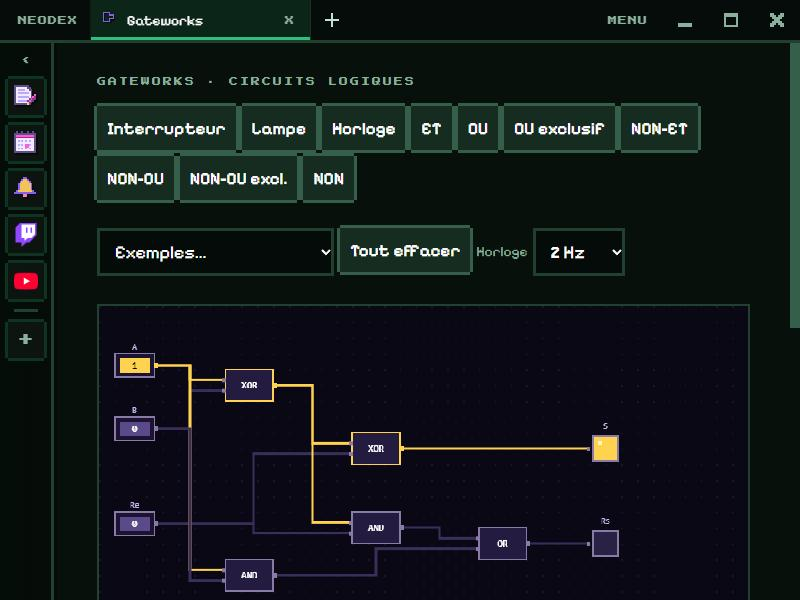

# Gateworks

Build logic circuits with the mouse and watch the current flow: wires light up in yellow when they are 1.

*Version française : [README.md](README.md)*

## Parts

- **Switch** (click to toggle it between 0 and 1), **Lamp**, **Clock** (ticks on its own, from 0.5 to 10 Hz).
- 7 gates: **AND**, **OR**, **NOT**, **XOR**, **NAND**, **NOR**, **XNOR**.

## Building

- Choose a part at the top, then click the grid to place it (as many times as you like; **Esc** to stop).
- **Drag** a part to move it.
- **Drag from an output** (the square on the right) **to an input** (on the left) to draw a wire. An input takes one wire: drawing a new one replaces the old one.
- **Right click** a part or a wire, or **Delete** on the hovered part: remove it.

## The truth table

It computes itself, for every combination of the switches (6 at most), and the row of the current state is highlighted. Loops work: a latch keeps its memory. A circuit that oscillates forever (a NOT gate wired to itself) is flagged, and the table shows it with **~**.

## Examples

Half adder, full adder, SR latch, multiplexer and blinker (with the clock).

## Data

The circuit and the clock speed are kept in the plugin folder. Permission: `storage` only.
