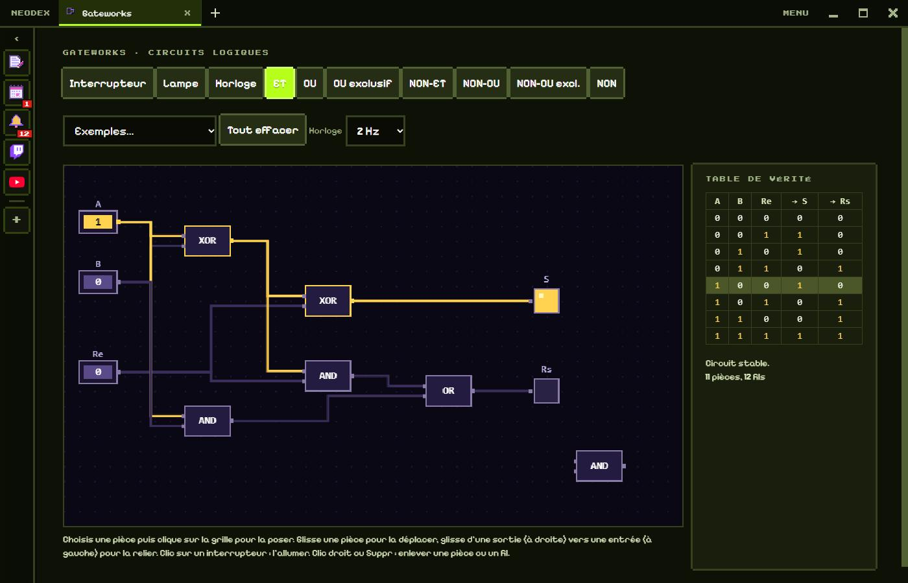

# Gateworks

Build logic circuits with the mouse and watch the current flow: wires light up in yellow when they are 1.

*Version française : [README.md](README.md)*

## From the gate to the processor (new in 1.1.0)

A path of 11 levels: you start with the NAND gate alone and build up to a small processor; each solved level becomes a reusable chip. And in the free workshop, you make your own chips.

## Parts

- **Switch** (click to toggle it between 0 and 1), **Lamp**, **Clock** (ticks on its own, from 0.5 to 10 Hz).
- 7 gates: **AND**, **OR**, **NOT**, **XOR**, **NAND**, **NOR**, **XNOR**.

## Building

- Choose a part at the top, then click the grid to place it (as many times as you like; **Esc** to stop).
- **Drag** a part to move it.
- **Drag from an output** (the square on the right) **to an input** (on the left) to draw a wire. An input takes one wire: drawing a new one replaces the old one.
- **Right click** a part or a wire, or **Delete** on the hovered part: remove it.

## The truth table

It computes itself, for every combination of the switches (6 at most), and the row of the current state is highlighted. Loops work: a latch keeps its memory. A circuit that oscillates forever (a NOT gate wired to itself) is flagged, and the table shows it with **~**.

## Examples

Half adder, full adder, SR latch, multiplexer and blinker (with the clock).

## Data

The circuit and the clock speed are kept in the plugin folder. Permission: `storage` only.

## Screen size (1.0.1)

The circuit uses the available space (window height, full width on a large screen) without stretching, and it is drawn at screen resolution: gates and labels stay sharp. The truth table and explanations are larger.

## The path: from the gate to the processor (1.1.0)

Choose **1. NOT** in the list at the top left. You start with the **NAND** gate alone, and each level you solve becomes a **chip** (a reusable block) for the next ones:

1. NOT · 2. AND · 3. OR · 4. Exclusive OR · 5. Half adder · 6. Full adder · 7. 2-bit adder · 8. Multiplexer · 9. Latch (memory) · 10. D flip-flop (memory at the pace of the clock) · 11. **Processor**: it loads or adds a value to its register on each clock edge.

- The inputs and outputs of the level are already placed. **CHECK** tries every combination (or, for memories, a series of steps) and says plainly what is wrong.
- In the truth table, wrong cells are red. **HINT** gives a clue.
- A wire can go back to an input of the same part: that is how a circuit remembers.
- Each level keeps your circuit; the next level opens when the previous one is solved.

## Make your own chips (1.1.0)

In the **free workshop**, **MAKE A CHIP** turns the circuit into a part: its switches become its inputs, its lamps its outputs (top to bottom). The chips earned in the path are there too. A chip keeps its own memory. Right-click a chip button: delete it.
