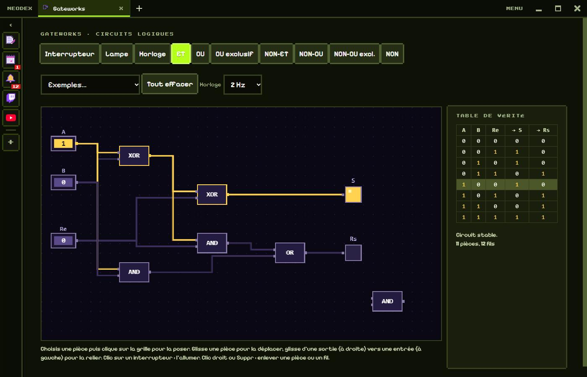

# Gateworks

Construis des circuits logiques à la souris et regarde le courant passer : les fils s'allument en jaune quand ils valent 1.

*English version: [README.en.md](README.en.md)*

## De la porte au processeur (nouveau en 1.1.0)

Un parcours de 11 niveaux : tu pars de la seule porte NON-ET et tu construis jusqu'à un petit processeur ; chaque niveau réussi devient une puce réutilisable. Et dans l'atelier libre, tu crées tes propres puces.

## Les pièces

- **Interrupteur** (clic pour le basculer entre 0 et 1), **Lampe**, **Horloge** (qui bat toute seule, de 0,5 à 10 Hz).
- 7 portes : **ET**, **OU**, **NON**, **OU exclusif**, **NON-ET**, **NON-OU**, **NON-OU exclusif**.

## Construire

- Choisis une pièce en haut, puis clique sur la grille pour la poser (autant de fois que tu veux ; **Échap** pour arrêter).
- **Glisse** une pièce pour la déplacer.
- **Glisse d'une sortie** (le carré à droite) **vers une entrée** (à gauche) pour tirer un fil. Une entrée n'a qu'un fil : en tirer un nouveau remplace l'ancien.
- **Clic droit** sur une pièce ou un fil, ou **Suppr** sur la pièce survolée : l'enlever.

## La table de vérité

Elle se calcule toute seule, pour toutes les combinaisons des interrupteurs (6 au plus), et la ligne de l'état actuel est surlignée. Les boucles marchent : une bascule garde sa mémoire. Un circuit qui oscille sans fin (une porte NON reliée à elle-même) est signalé, et la table l'indique par **~**.

## Exemples

Demi-additionneur, additionneur complet, bascule RS, multiplexeur et clignotant (avec l'horloge).

## Données

Le circuit et la vitesse de l'horloge sont gardés dans le dossier du plugin. Autorisation : `storage` seulement.

## Taille de l’écran (1.0.1)

Le circuit prend la place disponible (hauteur de la fenêtre, toute la largeur sur un grand écran) sans se déformer, et il est dessiné à la résolution de l’écran : les portes et leurs étiquettes restent nettes. La table de vérité et les explications sont plus grandes.

## Le parcours : de la porte au processeur (1.1.0)

Choisis **1. NON** dans la liste en haut à gauche. Tu ne pars que de la porte **NON-ET**, et chaque niveau réussi devient une **puce** (un bloc réutilisable) pour les suivants :

1. NON · 2. ET · 3. OU · 4. OU exclusif · 5. Demi-additionneur · 6. Additionneur complet · 7. Additionneur 2 bits · 8. Multiplexeur · 9. Verrou (la mémoire) · 10. Bascule D (la mémoire au rythme de l’horloge) · 11. **Processeur** : il charge ou ajoute une valeur à son registre à chaque front de l’horloge.

- Les entrées et les sorties du niveau sont déjà posées. **VÉRIFIER** essaie toutes les combinaisons (ou, pour les mémoires, une suite d’étapes) et dit en clair ce qui ne va pas.
- Dans la table de vérité, les cases fausses sont en rouge. **ASTUCE** donne une piste.
- Un fil peut revenir en arrière vers une entrée de la même pièce : c’est ainsi qu’un circuit se souvient.
- Chaque niveau garde ton circuit ; le niveau suivant s’ouvre quand le précédent est réussi.

## Créer ses puces (1.1.0)

Dans l’**atelier libre**, **CRÉER UNE PUCE** transforme le circuit en pièce : ses interrupteurs deviennent ses entrées, ses lampes ses sorties (de haut en bas). Les puces gagnées dans le parcours y sont aussi. Une puce garde sa propre mémoire. Clic droit sur le bouton d’une puce : la supprimer.
