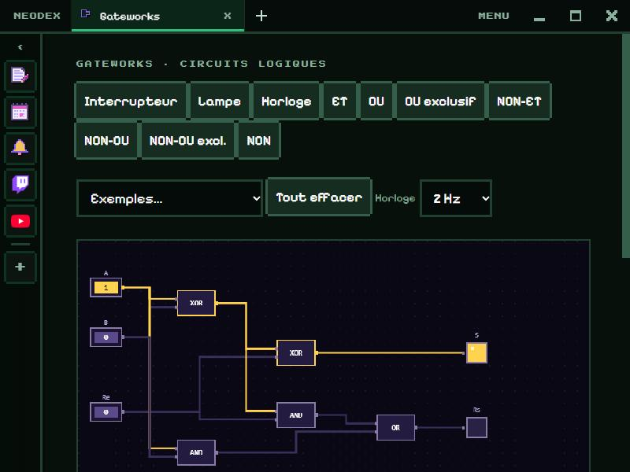

# Gateworks

Construis des circuits logiques à la souris et regarde le courant passer : les fils s'allument en jaune quand ils valent 1.

*English version: [README.en.md](README.en.md)*

## Les pièces

- **Interrupteur** (clic pour le basculer entre 0 et 1), **Lampe**, **Horloge** (qui bat toute seule, de 0,5 à 10 Hz).
- 7 portes : **ET**, **OU**, **NON**, **OU exclusif**, **NON-ET**, **NON-OU**, **NON-OU exclusif**.

## Construire

- Choisis une pièce en haut, puis clique sur la grille pour la poser (autant de fois que tu veux ; **Échap** pour arrêter).
- **Glisse** une pièce pour la déplacer.
- **Glisse d'une sortie** (le carré à droite) **vers une entrée** (à gauche) pour tirer un fil. Une entrée n'a qu'un fil : en tirer un nouveau remplace l'ancien.
- **Clic droit** sur une pièce ou un fil, ou **Suppr** sur la pièce survolée : l'enlever.

## La table de vérité

Elle se calcule toute seule, pour toutes les combinaisons des interrupteurs (6 au plus), et la ligne de l'état actuel est surlignée. Les boucles marchent : une bascule garde sa mémoire. Un circuit qui oscille sans fin (une porte NON reliée à elle-même) est signalé, et la table l'indique par **~**.

## Exemples

Demi-additionneur, additionneur complet, bascule RS, multiplexeur et clignotant (avec l'horloge).

## Données

Le circuit et la vitesse de l'horloge sont gardés dans le dossier du plugin. Autorisation : `storage` seulement.
